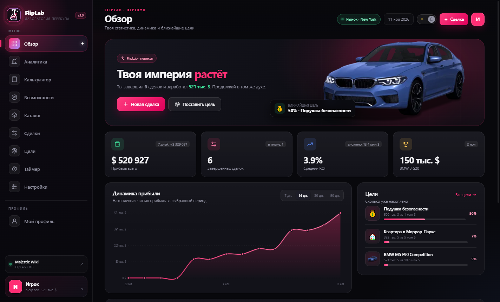
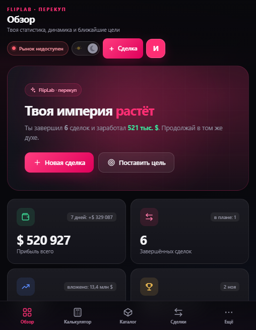
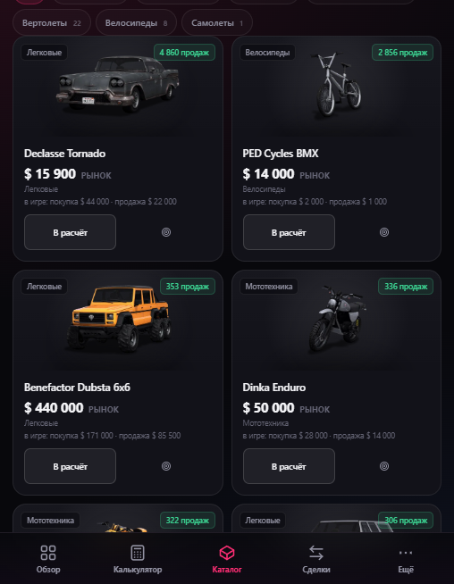
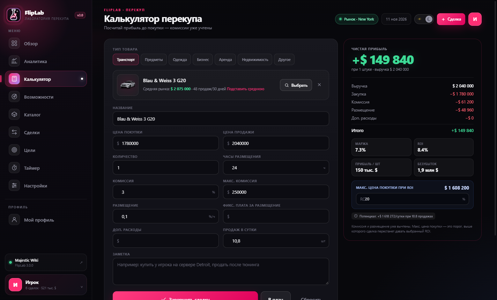
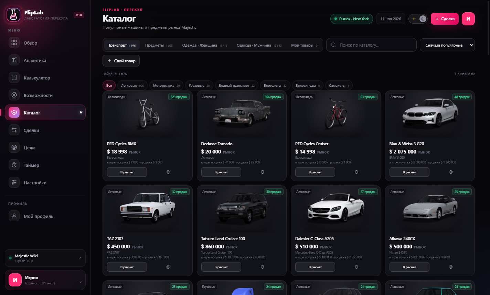
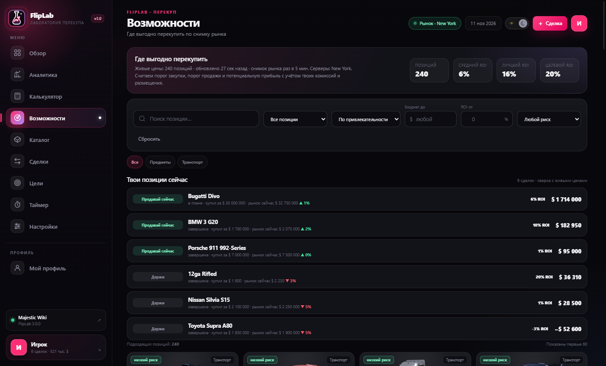

# FlipLab — лаборатория перекупа для Majestic RP

Настольная программа для Windows: считает прибыль с перекупа с учётом комиссий и размещения,
ведёт журнал сделок, следит за живыми ценами рынка и помогает копить на нужную покупку.

## Версия для Android

Та же программа в виде APK — с мобильным интерфейсом: нижнее меню вместо боковой панели,
сетки в две колонки, всё работает с телефона.

[Скачать FlipLab-3.0.0-android.apk](https://github.com/higes774-cmyk/FlipLab/releases/download/v3.0.0/FlipLab-3.0.0-android.apk) · 16,1 МБ · Android 6.0+ ·
SHA256 `4ECB3050CE7FC20F847AC054DF808982DDA2D55138BF736DB7899B60056750FA`

Установка: скопировать APK на телефон и открыть файл (разрешить установку из неизвестных
источников). Данные (профили, сделки, цели) хранятся в памяти приложения, живые цены
рынка тянутся напрямую с Majestic Wiki и обновляются каждые 5 минут.

## Что умеет

- **Калькулятор перекупа** — цена покупки, цена продажи, комиссия, лимит комиссии, размещение.
  Сразу показывает чистую прибыль, маржу, ROI, прибыль в сутки и максимальную цену покупки
  при заданном ROI.
- **Живые цены рынка** — снимок обновляется каждые 5 минут, сервер выбирается свой
  (New York, Detroit, San Francisco, Memphis и другие). Приложение докачивает рынок
  постранично, поэтому знает цены не только у самых ходовых позиций: на одном сервере это
  421 машина, 642 предмета и 4 148 вещей одежды.
- **Каталог на 28 099 позиций** — транспорт, предметы и одежда с Majestic Wiki: картинки,
  типы, описания, игровые цены и живая цена рынка. Одежда разделена на «Женщина» и «Мужчина»,
  есть поиск и фильтр по 49 типам.
- **«Возможности»** — где выгодно перекупить прямо сейчас: считает ROI от заданного порога
  и подсказывает, что продавать, а что придержать.
- **Журнал сделок и цели** — сценарий «план → купил → продал»: вбиваешь реальную цену продажи,
  прибыль и прогресс целей считаются сами. В настройках можно переключить режим на
  «завершать сделку автоматически».
- **Аналитика** — карта прибыли по категориям, динамика по дням, топ сделок и подсказки по рынку.
- **Таймер** — «жду продажи BMW» на 15 минут, повторяющийся звонок, когда время вышло.

## Скачать

Версия **3.0.0** (Windows 10/11, x64).

| Вариант | Файл | Размер |
|---|---|---|
| Установщик (Windows) | [FlipLab_3.0.0_Setup.exe](https://github.com/higes774-cmyk/FlipLab/releases/download/v3.0.0/FlipLab_3.0.0_Setup.exe) | 30,7 МБ |
| Портативная сборка (Windows) | [FlipLab.exe](https://github.com/higes774-cmyk/FlipLab/releases/download/v3.0.0/FlipLab.exe) | 27,0 МБ |
| **Android** | [FlipLab-3.0.0-android.apk](https://github.com/higes774-cmyk/FlipLab/releases/download/v3.0.0/FlipLab-3.0.0-android.apk) | 16,1 МБ |
| Архив для облаков | `FlipLab-3.0.0-setup-win-x64.zip` | 30,2 МБ |
| Контрольные суммы | [SHA256SUMS.txt](https://github.com/higes774-cmyk/FlipLab/releases/download/v3.0.0/SHA256SUMS.txt) | — |
| Частые проблемы | [ФИКС ОШИБОК.txt](https://github.com/higes774-cmyk/FlipLab/blob/main/%D0%A4%D0%98%D0%9A%D0%A1%20%D0%9E%D0%A8%D0%95%D0%91%D0%9E%D0%9A.txt) | — |

Все релизы: https://github.com/higes774-cmyk/FlipLab/releases

### Установка

1. Запусти `FlipLab_3.0.0_Setup.exe`.
2. Выбери папку (по умолчанию — для текущего пользователя, права администратора не нужны).
3. Если нет Microsoft Edge WebView2 Runtime, установщик поставит его сам (нужен интернет).

> Установщик не подписан сертификатом, поэтому SmartScreen может предупредить —
> выбери **Подробнее → Выполнить всё равно**.

## Что нового в 3.0.0

- **Цены починены.** Раньше тянулись только 60 позиций с каждой вкладки рынка — теперь
  приложение докачивает рынок целиком через JSON-API Majestic Wiki и обновляет цены постоянно.
  Позиции каталога сопоставляются с рынком по точному id, поэтому цена находится даже там,
  где названия отличаются.
- **Режим завершения сделок:** автоматически или вручную (план → «Купил» → «Завершить сделку»
  с реальной ценой продажи).
- **Починен баг:** при правке существующей сделки менялась не та цена.
- **Картинки больше не обрезаются** — портретные предметы и одежда видны целиком.
- **Одежда разделена на женскую и мужскую** с отдельными вкладками и фильтрами.
- **Каталог переделан под wiki Majestic:** 28 099 позиций вместо 141, с картинками и описаниями.

## Требования

- Windows 10 (1809) или новее, x64
- Microsoft Edge WebView2 Runtime (установщик поставит сам)
- Интернет для живых цен (без сети приложение покажет последний снимок)

## Частые проблемы

Всё собрано в файле [«ФИКС ОШИБОК.txt»](https://github.com/higes774-cmyk/FlipLab/releases/download/v3.0.0/%D0%A4%D0%98%D0%9A%D0%A1%20%D0%9E%D0%A8%D0%95%D0%91%D0%9E%D0%9A.txt).
Журнал запуска: `%APPDATA%\FlipLab\app.log`.

---

*Неофициальный фанатский инструмент, не связан с администрацией Majestic RP.
Цены и правила рынка меняются — сверяйся с игрой и официальными источниками.*
